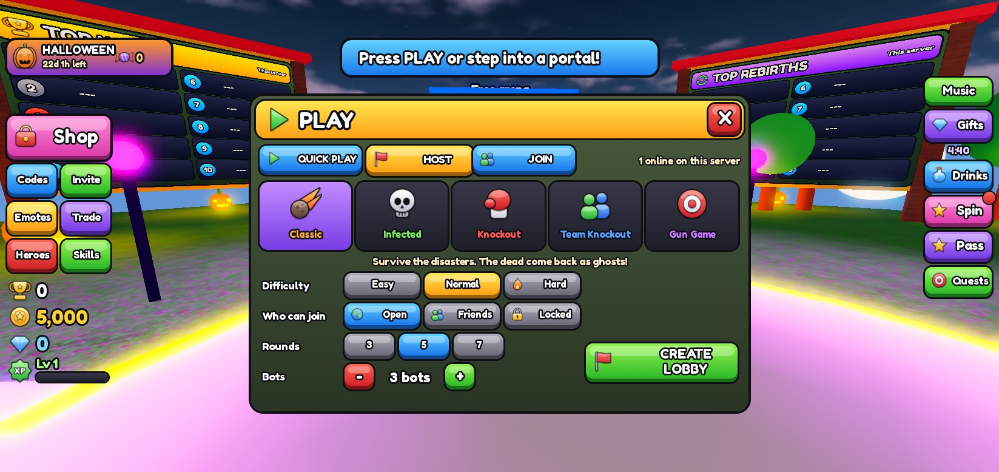
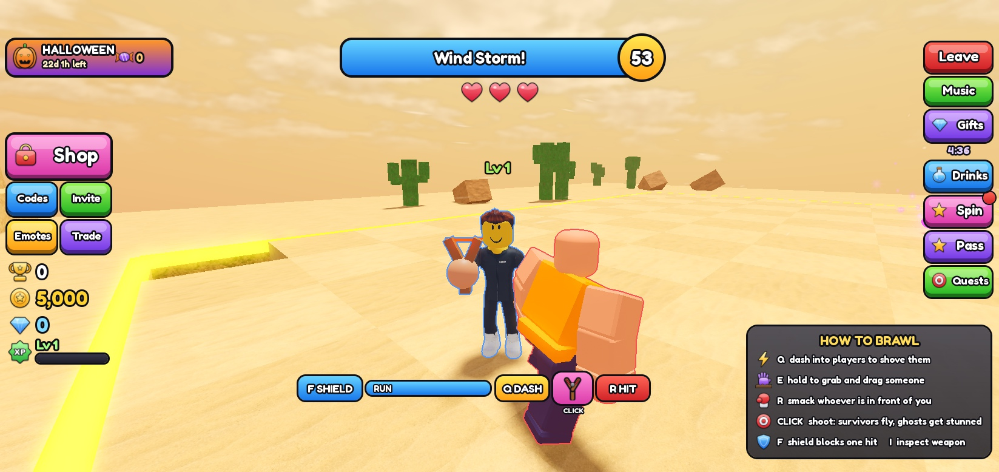
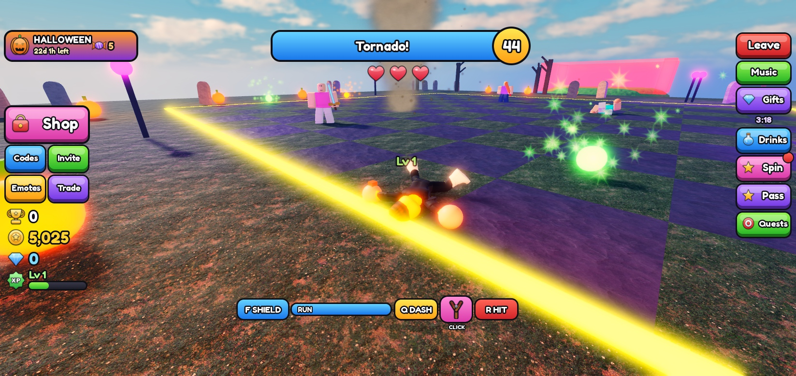
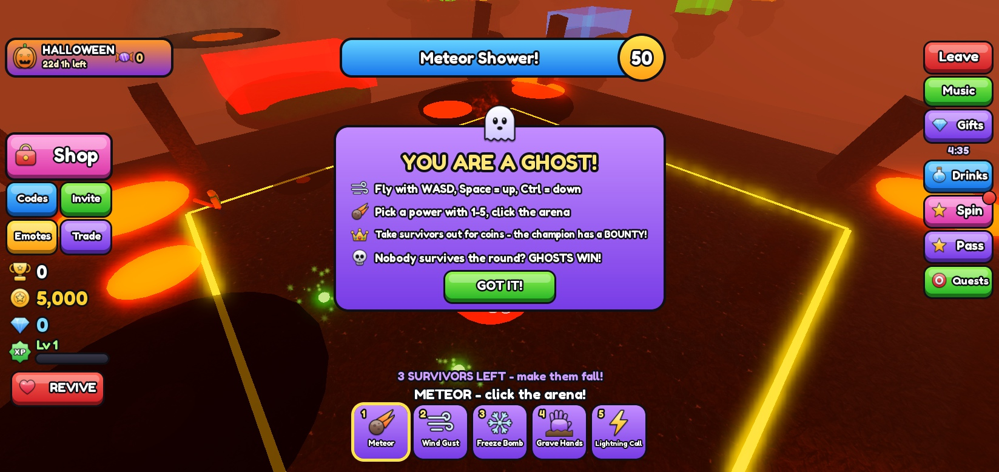
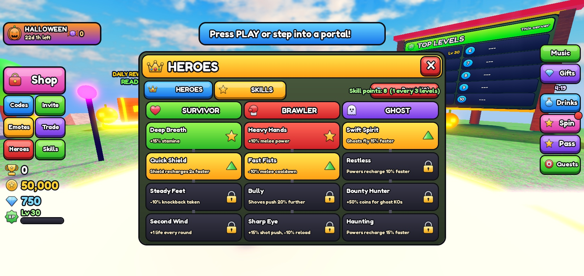
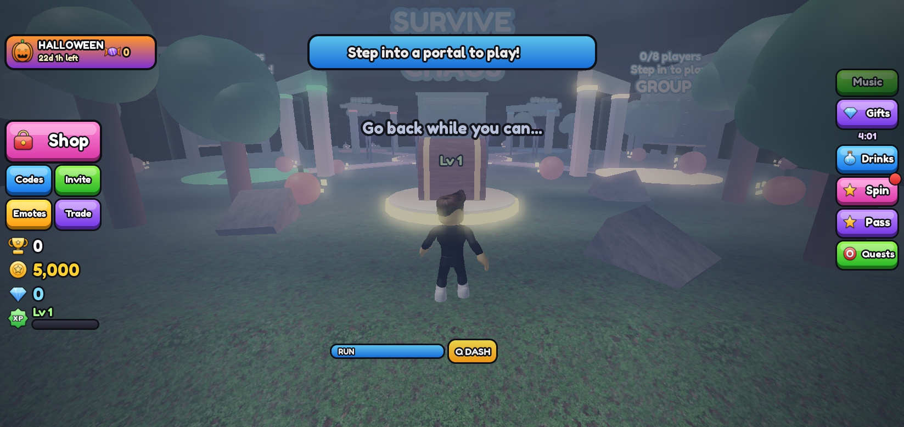
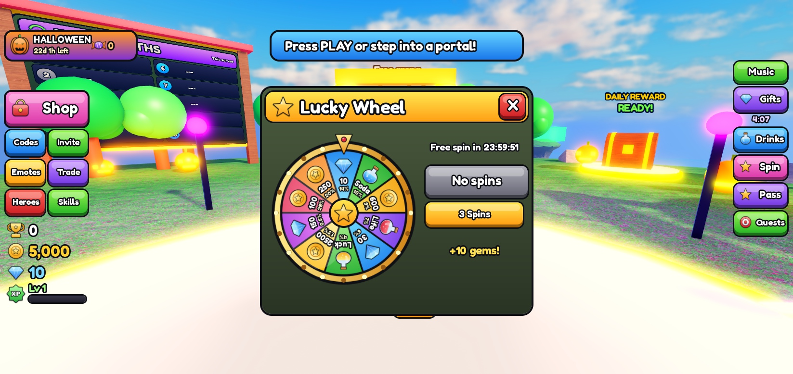
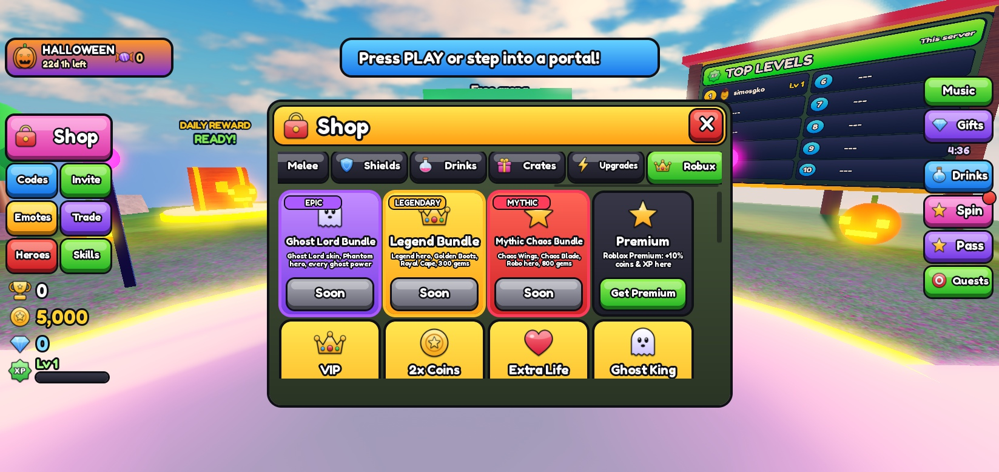
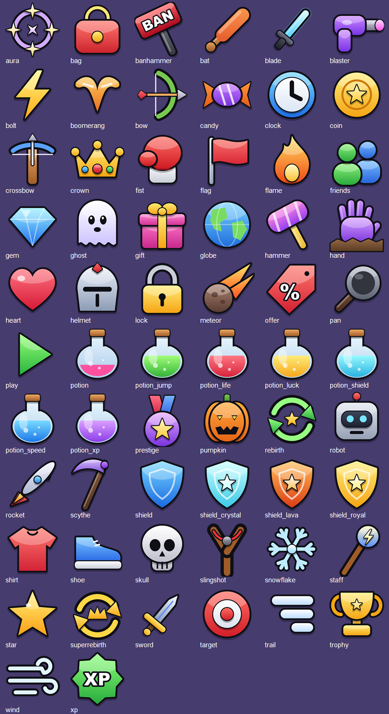
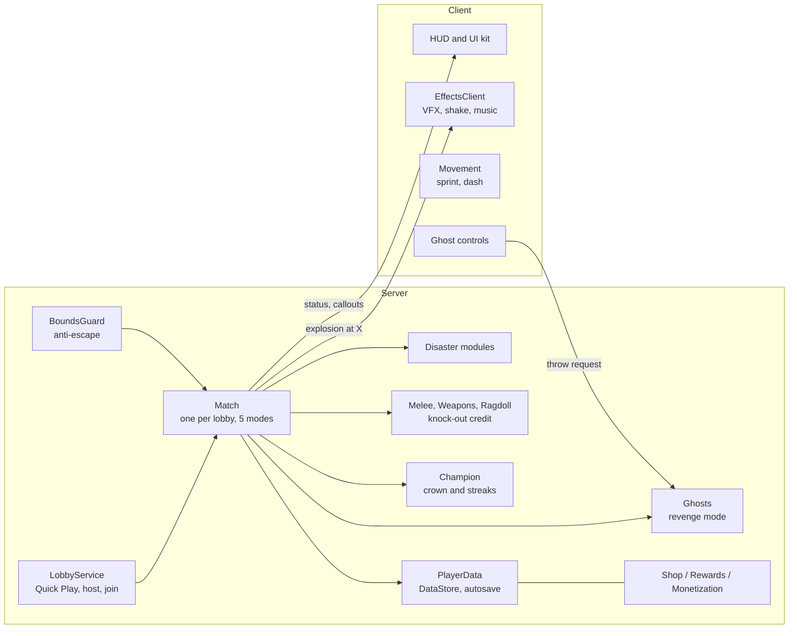

  

# Survive the Chaos

**A multiplayer party-brawler and disaster-survival game for Roblox.** Up to 8 players (plus bots) host or join a lobby and play five modes: survive disasters, smack each other off the arena Fall Guys style, escape the infected or climb the Gun Game ladder.
The twist: **dying is not the end.** Eliminated players come back as flying ghosts with powers and try to make the survivors lose.

> Status: in development, release planned on Roblox.
> This repository is a **showcase** (screenshots, architecture, selected code). The full game source is kept private.

---

## My role

I came up with the game concept, made all design decisions and directed, tested and polished the game:
the core hook (ghost revenge), game modes and balancing, the look & feel of the UI, the group lobby, the shop and progression systems, the release plan and the thumbnails.

The implementation was built **together with Claude Code (AI)**, which I directed step by step:
I defined features, reviewed every result in Roblox Studio, reported bugs and decided what to change.
Every commit in the project history is marked as co-authored with Claude.

## Gameplay

| | |
|---|---|
|  |  |
| **Lobby** with 4 group portals, leaderboard and daily reward chest | **Round** with live status, timer and stamina |
|  |  |
| **Ghost mode**: dead players throw meteors at survivors | **Shop** with cosmetics, upgrades and Robux items |
|  |  |
| **Play menu**: Quick Play, Host (mode, difficulty, privacy, rounds, bots) and Join | **Team Knockout**: red vs blue outlines, no friendly fire |
|  |  |
| **Ragdolls**: every hit, shove and explosion throws a floppy body | **Ghost tutorial** and the survivors-left goal line |
|  |  |
| **Skill tree**: Survivor, Brawler and Ghost branches | **Spooky border**: grey world, fog, cold wind, the music stops |
|  |  |
| **Lucky wheel**: painted wheel, rim lights, odds on every slice | **Robux shop**: Epic, Legendary and Mythic bundles |

## Thumbnails

| | |
|---|---|
|  |  |
|  |  |
## Features

- **5 game modes**: Classic (disasters + ghosts), Infected (touch to infect), Knockout (free for all, no walls at the edge), Team Knockout (red vs blue) and Gun Game (every knock-out upgrades your weapon)
- **Lobbies**: Quick Play, hosted lobbies with mode, difficulty (Easy / Normal / Hard), rounds and bot count, open / friends-only / locked with a code, a lobby browser, host hand-over; parties stay together after a match
- **Ragdoll physics** for the new avatar joints and classic rigs: shoves, hits, gusts and explosions throw floppy bodies around
- **Melee** on its own key with an 8-step tree (fists to Ban Hammer) and **ranged weapons that push survivors** and stun ghosts; knock-outs are credited to the last hitter
- **9 heroes** with stats and visible gear on top of the player's own avatar, a **skill tree** with three branches, suits, shoes and helmets with rarities from Common to Mythic
- **Atmosphere**: sky, light and weather per map (snow, ash, dust, fireflies), a day cycle in the lobby and a spooky effect when you leave the play area
- **19 challenges**: meteor shower, collapsing floor, shrinking arena, spinning laser, hunting lightning, boulders, color chaos, Block Party, Jump Showdown, Crumble Floor, Hammer Time, Sweeper, Tornado, Ice Age, Bomb Rain, Spike Trap, Floor Is Lava, Wind Storm, Pumpkin Bombs (Halloween)
- **Chaos rounds**: from round 2, two disasters can run at the same time (never two floor-destroying ones)
- **Fall Guys style brawling**: dash into players to shove them, hold E to grab and drag them
- **Flying ghosts with powers**: meteor, wind gust, freeze bomb, grave hands and lightning call; the ghost team wins when nobody survives
- **Ghost revenge**: eliminated players become ghosts and earn coins for hitting survivors
- **Fight back**: survivors unlock a weapon tree (slingshot, bow, crossbow, plasma blaster) and stun ghosts so they can't throw
- **Lives and shield**: 3 lives per round with a short invulnerability after a hit, plus a shield ability on a cooldown
- **6 themed maps**: Sky Arena, Downtown, Desert Dunes, Wild Forest, Frozen Peaks and Volcano, picked at random each round
- **Bots**: small groups are filled with bots that dodge hazards, jump the laser and come back as ghost bots, each with its own reaction time and skill
- **Champion system**: the last survivor wears a crown and a bounty that grows with every win streak
- **Group lobby**: 4 portals, up to 8 players per group, up to 4 matches running in parallel on one server
- **Movement**: sprint with stamina and a dash with wall-collision checks
- **Mobile ready**: the whole UI scales down automatically on phones, custom touch buttons are placed next to the jump button, landscape lock
- **Progression**: XP and levels, Rebirth, Super Rebirth and Prestige, a 30-tier season pass, crates with shown odds, a daily lucky wheel
- **Collection**: 7-weapon tree, 4 shields, 6 drinks, trails, layered particle auras, 10 hats, ghost skins, crate-exclusive and season-exclusive items
- **Live ops**: server events (Double Coins, Double XP, Gem Rain, Chaos Overload) started randomly, by players (Chaos Hour) or by the owner
- **Seasonal events**: Halloween with candy currency, a limited shop, a haunted map and a Halloween-only disaster, switched on by date
- **Social**: daily quests, emote wheel, safe server-checked trading, lobby leaderboards for wins, levels and rebirths
- **Retention**: welcome gift, playtime gifts, 7-day daily reward streak, redeemable codes, all-time wins leaderboard
- **Monetization**: game passes, coin / gem packs and Epic / Legendary / Mythic bundles with Robux-only items, safe idempotent receipt handling
- **Juice**: custom cartoon UI kit, client-side VFX (explosions, lightning, impact stars, camera shake), licensed combat sounds and music, idle moves and weapon inspect

## Icons

All UI icons are painted by a script (gradients, outlines, gloss) and uploaded to Roblox:

## Architecture

**Key decisions**

- **Server-authoritative**: every purchase, upgrade, code, ghost throw and weapon shot is validated on the server (cooldowns, bounds, prices, rate limits).
- **Bots without special cases**: a bot is a character model with an `IsBot` attribute, so hazards, lives and effects treat it like a player, while rewards and saving only ever touch real players.
- **Isolated matches**: each group runs in its own `Match` object with its own arena, ghosts and champion, so several groups play in parallel without interfering.
- **Disasters as plug-ins**: each disaster is a module with `Name`, `Run(ctx)` and an optional `Floor` flag. Adding a disaster means adding one file.
- **Smooth effects**: the server only sends "explosion at X"; clients render VFX and sound locally.
- **Safe saving**: data is only written back if it was loaded successfully, so a failed load can never wipe a player's progress. Purchases are idempotent.

## Quality and testing

The game was playtested in Roblox Studio with real mouse and keyboard input after every feature, plus targeted stress tests:

- 60 FPS on client and 60 Hz on the server, also with 4 disasters running at once
- No memory leaks: the instance count after a round equals the baseline
- Tested on phone screens with Studio's device simulator (smallest: 780x360)
- Bugs found and fixed during testing included ghosts unable to aim after the lobby rework, players able to escape the play area, the dash tunneling through thin walls, and UI layering issues

## Code samples

Selected modules from the game (shared for review, see license below):

- [`Match.luau`](code-samples/Match.luau): match and round lifecycle for all five modes, teams, infection, Gun Game, knock-out credit, rewards
- [`Ghosts.luau`](code-samples/Ghosts.luau): ghost mode with server-side validation
- [`Ragdoll.luau`](code-samples/Ragdoll.luau): server-driven ragdolls for new AnimationConstraint and classic Motor6D rigs
- [`Melee.luau`](code-samples/Melee.luau): melee weapons built from parts, procedural swing animation, server hit checks
- [`Bots.luau`](code-samples/Bots.luau): bot AI (hazard prediction, laser jump timing, ghost bots)
- [`UIKit.luau`](code-samples/UIKit.luau): cartoon UI kit (3D buttons, windows, icons drawn from frames)
- [`EffectsClient.client.luau`](code-samples/EffectsClient.client.luau): client VFX, camera shake, music

## Tech

Roblox Studio · Luau · Rojo project layout · Git · Claude Code

---

© 2026 Symeon Gkotzamanidis. All rights reserved. The code and media in this repository are shown for portfolio purposes only and may not be copied or reused.
