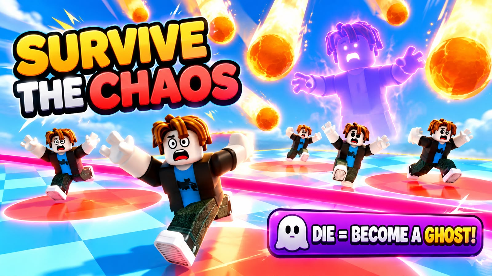
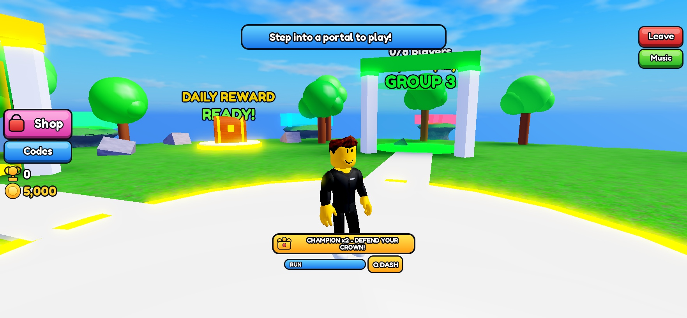
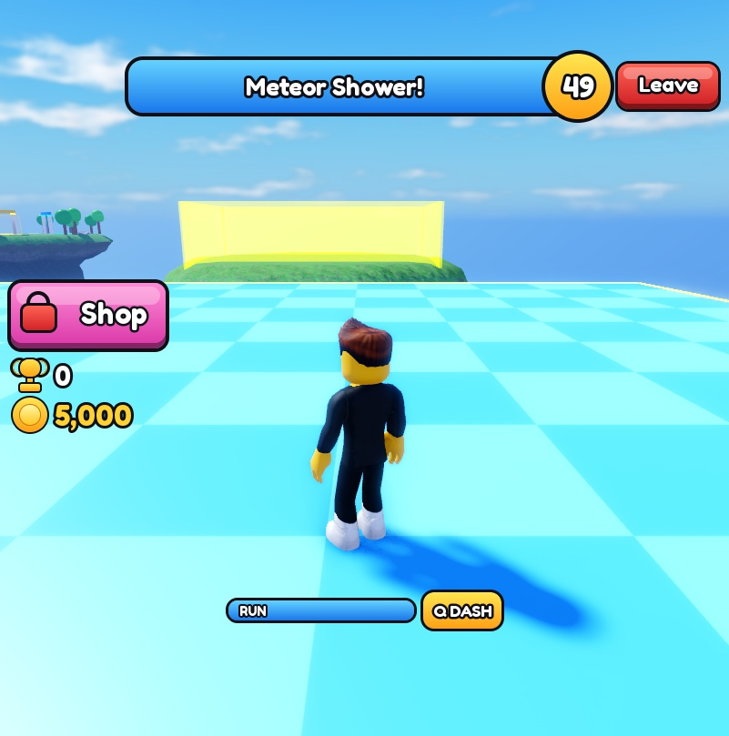
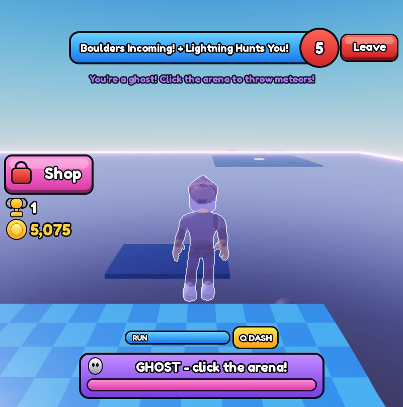
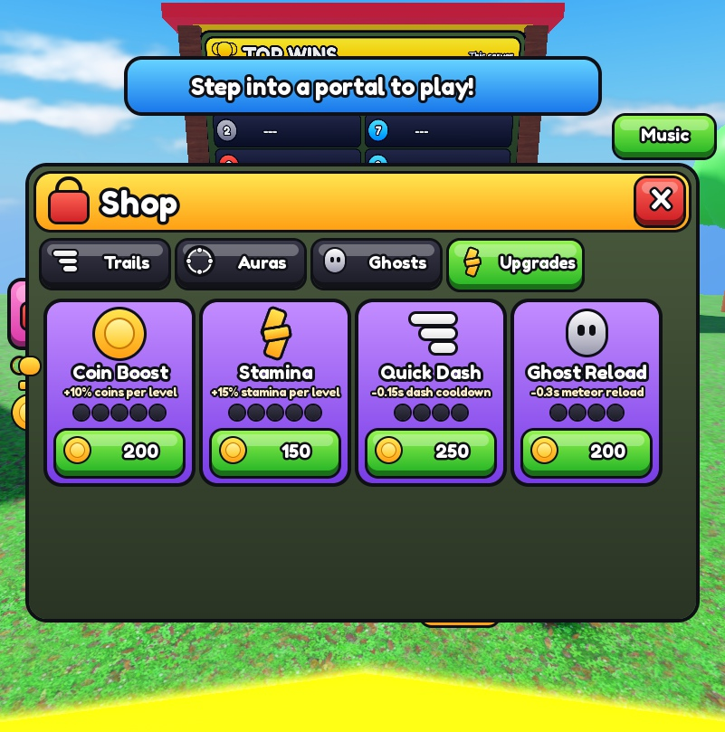
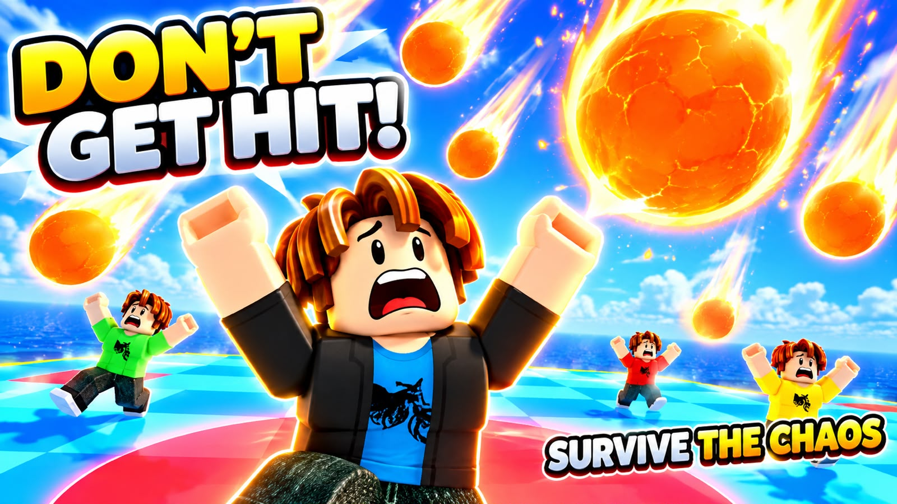
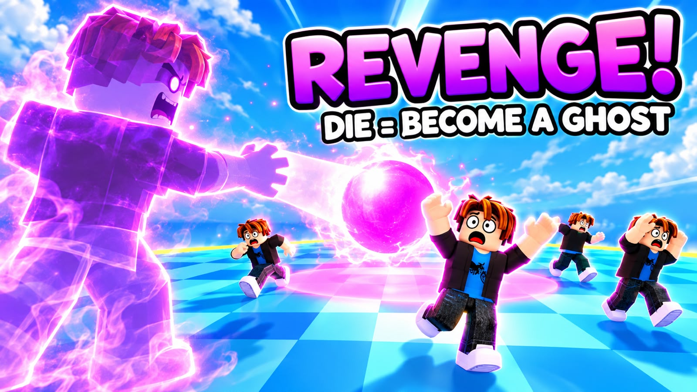
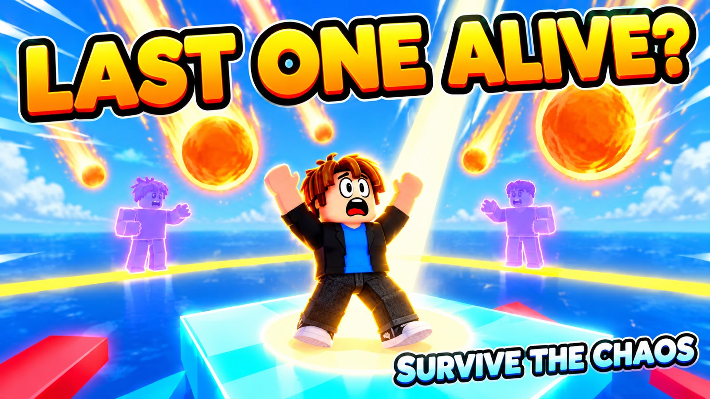
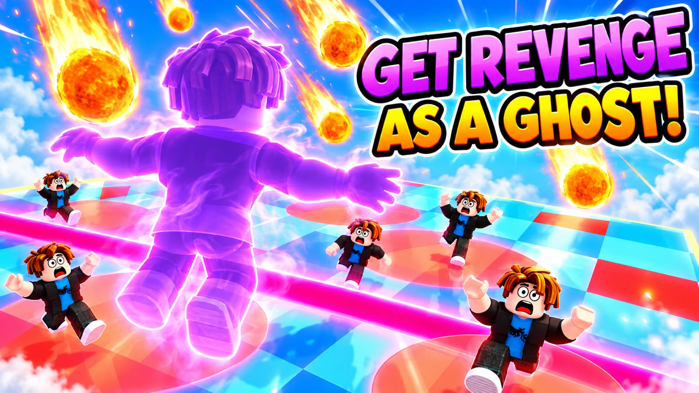
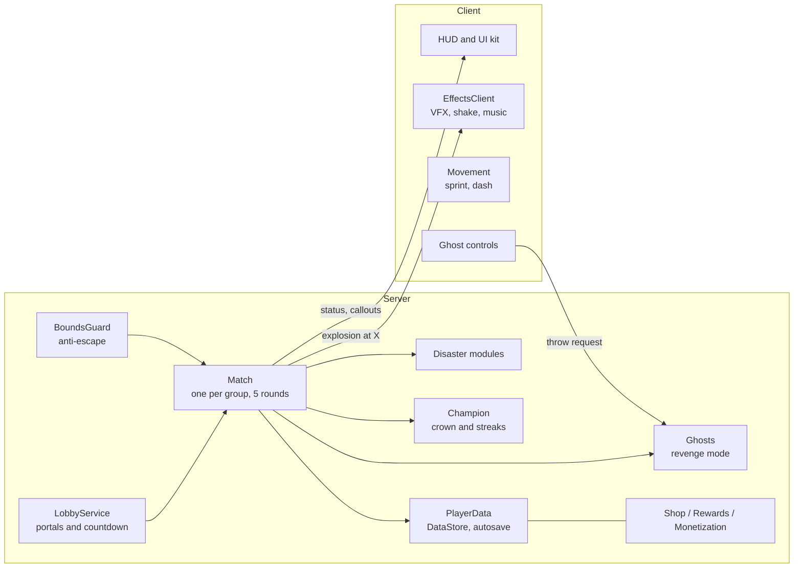

  

# Survive the Chaos

**A multiplayer disaster-survival game for Roblox.** Groups of up to 8 players jump into a portal and survive 5 rounds of meteors, lightning, boulders and collapsing floors.
The twist: **dying is not the end.** Eliminated players come back as ghosts, float above the arena and throw meteors at the survivors.

> Status: in development, release planned on Roblox.
> This repository is a **showcase** (screenshots, architecture, selected code). The full game source is kept private.

---

## My role

I came up with the game concept, made all design decisions and directed, tested and polished the game:
the core hook (ghost revenge), game modes and balancing, the look & feel of the UI, the group lobby, the shop and progression systems, the release plan and the thumbnails.

The implementation was built **together with Claude Code (AI)**, which I directed step by step:
I defined features, reviewed every result in Roblox Studio, reported bugs and decided what to change.
Every commit in the project history is marked as co-authored with Claude.

## Gameplay

| | |
|---|---|
|  |  |
| **Lobby** with 4 group portals, leaderboard and daily reward chest | **Round** with live status, timer and stamina |
|  |  |
| **Ghost mode**: dead players throw meteors at survivors | **Shop** with cosmetics, upgrades and Robux items |

## Thumbnails

| | |
|---|---|
|  |  |
|  |  |
## Features

- **7 disasters**: meteor shower, collapsing floor, shrinking arena, spinning laser, lightning that hunts players, rolling boulders, color chaos
- **Chaos rounds**: from round 3, two disasters can run at the same time (never two floor-destroying ones)
- **Ghost revenge**: eliminated players become ghosts and earn coins for hitting survivors
- **Fight back**: survivors unlock a weapon tree (slingshot, bow, crossbow, plasma blaster) and stun ghosts so they can't throw
- **Lives and shield**: 3 lives per round with a short invulnerability after a hit, plus a shield ability on a cooldown
- **6 themed maps**: Sky Arena, Downtown, Desert Dunes, Wild Forest, Frozen Peaks and Volcano, picked at random each round
- **Bots**: small groups are filled with bots that dodge hazards, jump the laser and come back as ghost bots, each with its own reaction time and skill
- **Champion system**: the last survivor wears a crown and is hunted (2x bounty for ghosts, win streaks)
- **Group lobby**: 4 portals, up to 8 players per group, up to 4 matches running in parallel on one server
- **Movement**: sprint with stamina and a dash with wall-collision checks
- **Mobile ready**: the whole UI scales down automatically on phones, custom touch buttons are placed next to the jump button, landscape lock
- **Progression**: coins and gems, cosmetics (trails, auras, ghost skins), permanent upgrades and prestige (reset for a permanent coin bonus and a badge), saved per player
- **Retention**: welcome gift, playtime gifts, 7-day daily reward streak, redeemable codes, all-time wins leaderboard
- **Monetization**: game passes and coin packs with safe, idempotent receipt handling
- **Juice**: custom cartoon UI kit, client-side VFX (explosions, lightning, camera shake), licensed sound and music

## Architecture

**Key decisions**

- **Server-authoritative**: every purchase, upgrade, code, ghost throw and weapon shot is validated on the server (cooldowns, bounds, prices, rate limits).
- **Bots without special cases**: a bot is a character model with an `IsBot` attribute, so hazards, lives and effects treat it like a player, while rewards and saving only ever touch real players.
- **Isolated matches**: each group runs in its own `Match` object with its own arena, ghosts and champion, so several groups play in parallel without interfering.
- **Disasters as plug-ins**: each disaster is a module with `Name`, `Run(ctx)` and an optional `Floor` flag. Adding a disaster means adding one file.
- **Smooth effects**: the server only sends "explosion at X"; clients render VFX and sound locally.
- **Safe saving**: data is only written back if it was loaded successfully, so a failed load can never wipe a player's progress. Purchases are idempotent.

## Quality and testing

The game was playtested in Roblox Studio with real mouse and keyboard input after every feature, plus targeted stress tests:

- 60 FPS on client and 60 Hz on the server, also with 4 disasters running at once
- No memory leaks: the instance count after a round equals the baseline
- Tested on phone screens with Studio's device simulator (smallest: 780x360)
- Bugs found and fixed during testing included ghosts unable to aim after the lobby rework, players able to escape the play area, the dash tunneling through thin walls, and UI layering issues

## Code samples

Selected modules from the game (shared for review, see license below):

- [`Match.luau`](code-samples/Match.luau): match and round lifecycle, disaster selection, rewards
- [`Ghosts.luau`](code-samples/Ghosts.luau): ghost mode with server-side validation
- [`Bots.luau`](code-samples/Bots.luau): bot AI (hazard prediction, laser jump timing, ghost bots)
- [`UIKit.luau`](code-samples/UIKit.luau): cartoon UI kit (3D buttons, windows, icons drawn from frames)
- [`EffectsClient.client.luau`](code-samples/EffectsClient.client.luau): client VFX, camera shake, music

## Tech

Roblox Studio · Luau · Rojo project layout · Git · Claude Code

---

© 2026 Symeon Gkotzamanidis. All rights reserved. The code and media in this repository are shown for portfolio purposes only and may not be copied or reused.
